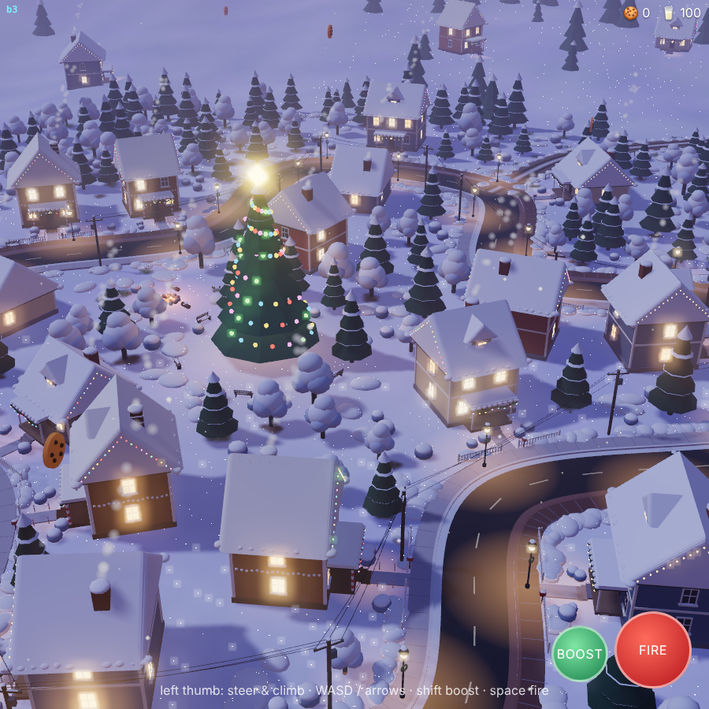

# Santa Slays

A cozy, slightly raunchy flying game: a chunky cartoon Santa in a decked-out sleigh, pulled on ropes by a team of
buff reindeer, with a minigun on the rail, flying over a snow-globe village. Milk and cookies are his fuel.

Three.js r180 (vendored in `vendor/`), native ES modules, **no build step**. Mobile first; later wrapped for iOS with Capacitor.

**Play:** open `index.html` from any static server (`python3 -m http.server`), or the GitHub Pages URL once Pages is on.

## Controls
| | touch | keyboard |
|---|---|---|
| steer / climb / dive | left thumb anywhere on the left half (floating stick) | WASD / arrows |
| boost (drinks milk) | BOOST | Shift |
| machine gun | FIRE (hold) | Space |

Fly through the floating cookies to refill milk.

## Layout
- `index.html` - page, HUD, import map
- `src/main.js` - renderer, chase camera, minigun, cookies, the loop
- `src/world.js` - the snow diorama (sky, terrain, village, tree, forest, smoke, snowfall)
- `src/sleigh.js` - reindeer team + rope-tethered sleigh physics, primitive stand-in models, `FLY` tuning table
- `src/rope.js` - verlet ropes drawn as tubes
- `models/` - put real GLB models here (see `models/README.md`)

`?cam=diorama` = a fixed high view of the village (the reference framing). `?scene=kit` = the kit showroom (drag to orbit). `?bloom=0` = no bloom. `?cam=crew` = close look at Santa + the elves. `?scene=sandbox` = the white character sandbox (clip buttons, FIRE). `?look=flat` = the illustration look (also the LOOK chip).
